# Kab Tak? Final project report

**Srujana Tech Fest 2026 · Finance theme · Problem statement F-03: Predictive Cash-Flow Management for Small Businesses**

Repository: https://github.com/sankalp-happy/Srujana_hackathon2026_KabTak · Live demo: https://172-198-161-228.sslip.io · WhatsApp bot: +91 6205 559 096

Every number in this report comes from code in the repository or from a command that was run for this report on 26 Oct 2026 (Apple M1, Python 3.12.1, numpy 1.26.4, pandas 2.2.1). Each figure gives the command that reproduces it. All demo businesses are **synthetic**. Kab Tak? computes and compares options; it is **not financial or legal advice**.

---

## 1. Project overview

| | |
|---|---|
| **Project title** | Kab Tak? ("How long?"): predictive cash flow for small businesses |
| **Team name** | TODO (team): add the registered team name |
| **Theme** | Finance |
| **Problem statement** | F-03, Predictive Cash-Flow Management for Small Businesses (official list from the organisers) |
| **Event** | Srujana Tech Fest 2026, Chanakya University, 24 to 26 Oct 2026 (48 hours) |

### Executive summary

Kab Tak? forecasts a small business's cash as a range of outcomes, not one line. It answers the owner's real questions on WhatsApp, by text or voice note. "Can I pay wages on the 7th?" "What if Buyer A pays a month late?" "Can I take a ₹12 lakh order on 90-day terms?"

An owner signs up on a website and can upload their invoices and bills as an Excel workbook. They then ask questions on WhatsApp. The engine learns how late each buyer really pays, using a Kaplan–Meier survival curve per buyer in which unpaid invoices count as "not paid yet". It then plays out the next 90 days 1,000 times. In each run, one buyer's invoices move together through a shared shock, and the bank's lending limit (drawing power) shrinks as invoices age past 90 days. The answer comes back as:

- the chance of missing a payment in each week, and the riskiest week;
- how many days late each buyer can pay before the risk passes 5% ("kab tak?");
- for a new order, the longest safe payment terms and the smallest safe advance.

A language model only turns the question into a typed scenario and phrases the answer. It never computes a number. The owner confirms a read-back before anything runs, and any sentence the model writes that contains a number the engine did not produce is dropped.

**What it is today:** a working, deployed prototype. It forecasts and compares, but it does not yet suggest fixes (§11). All demo data is synthetic. On one external public dataset the model did **not** beat a published baseline (§8).

### The problem being addressed

A profitable small business can still fail to pay wages. Profit sits in unpaid invoices while wages, loan instalments, GST and supplier bills fall due on fixed dates. In India the scale is large: delayed payments owed to MSMEs were estimated at ₹7.34 lakh crore as of March 2024 (GAME–FISME–C2FO Delayed Payments Report 3.0) and ₹10.7 lakh crore in 2022 (GAME–D&B), as collected in `docs/planning/f03-research-notes.md`.

The tools owners use, such as TallyPrime and Zoho Books, record what happened. Their cash projections assume each invoice is paid on its due date, or on a date the owner types in. The owner still has to guess how late each buyer will really pay, whether the overdraft will cover the gap, and whether a new order on long credit terms is safe.

---

## 2. Problem understanding

### Target users

- **Primary: the owner of an Indian micro or small manufacturer or trader.** Our design persona is a constructed composite, not a real person. They own a 14-person CNC precision-components shop in Bhosari, Pune, with turnover of about ₹3 crore and three to four main buyers (two auto Tier-1s and a public-sector company). They have a bank overdraft that is mostly drawn. They work on WhatsApp in Marathi or Hindi. Their weekly question is "Can I pay wages on the 7th, and should I take this new order?"
- **Secondary: their chartered accountant (CA)**, who keeps the books (often in TallyPrime) and wants to check the working.

### Pain points

1. **Due dates are fiction.** Buyers pay late, and differently. The persona's ledger has a public-sector buyer paying at a median of about 85 days on 45-day terms.
2. **One late buyer hurts twice.** The cash arrives later, and invoices older than 90 days stop counting toward the bank's drawing power, so the overdraft limit shrinks at the same moment.
3. **A single forecast line hides risk.** What the owner needs to know is *how likely* a missed payment is, and *in which week*.
4. **Decisions need numbers.** "Take this order?" turns into "on what terms, and with what advance?"
5. **Channel and language.** Owners live on WhatsApp and in their own language, not on dashboards.

### Why it matters

A missed wage or EMI date costs more than its amount: staff trust, penalty interest and the bank relationship all suffer. The owner usually decides by gut feel or by calling the CA. A tool that turns "what if" into "the chance of missing a payment, and in which week" lets the owner act before the week arrives: chase a buyer, ask for an advance, or decline long terms.

### Assumptions (stated, not hidden)

Kab Tak? relies on assumptions that are **not fitted to real data**. The engine lists them in every result:

| Assumption | Value | Where in code |
|---|---|---|
| Correlation of payment shocks within one buyer | ρ = 0.6 | `engine/ledger.py` `RHO` |
| Chance that payments in the last 10 days of a quarter slip into the next | 30% | `P_QTR_SLIP` |
| Drawing power | 75% of (stock − unpaid supplier bills) + 60% of receivables under 90 days old, capped at the overdraft limit | `drawing_power()`, `DP_*` |
| GST | 18%, paid on the 20th of the next month, on accrual | `GST_RATE`, `_next_20th` |
| TDS deducted by buyers | 2% of taxable value (s.194C) | `TDS_RATE` |
| Risk target | 5% chance of a shortfall | `RISK_TARGET` |
| Thin history | under 5 paid invoices: pooled curve; under 10 in the whole business: default lognormal curve, median 45 days | `engine/arrival.py` |
| New order (CNC-specific) | bar stock = 45% of order value, paid on day 7; invoice raised on day 30; 9% contribution margin; new buyer pays like the business's middle buyer | `engine/simulate.py`, `ledger.MATERIAL_SHARE`, `ORDER_MARGIN_PCT` |

A business can override these in `profile.json` (`params`). For example, the textile demo business uses 5% GST and 0% TDS.

### Specific needs addressed

| Need | How Kab Tak? addresses it |
|---|---|
| Current liquidity | Today card: bank balance, undrawn overdraft headroom, money owed, money more than 45 days overdue |
| Anticipate shortfalls | The chance of a shortfall in each of the next 13 weeks, the riskiest week, and the bills due in it |
| Expected vs actually received | A payment-delay curve per buyer; a view of contractual due dates against simulated arrivals |
| Simulate delays, expense shocks, new orders and promised payments | Typed scenarios: `delay_payment`, `expense_shock`, `new_order`, `payment_received` |
| Record real data | `add_invoice` and `add_obligation` over WhatsApp, with GST and TDS computed in code, plus *undo* and *reset* |
| Compare responses | "Kab tak?" per buyer, safe order terms and minimum advance, before-vs-after risk. **Pricing and ranking fixes is not built** (§11). |

---

## 3. Proposed solution

### How it works

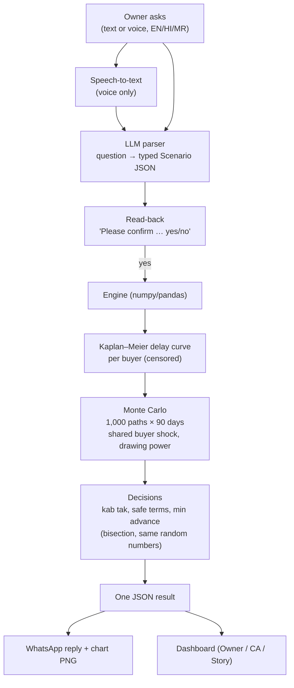

1. **Data.** Each business is a folder of CSV/JSON files: invoices (paid and open), dated obligations (wages, EMI, rent, power, GST, supplier bills, bonus, advance tax), and the bank position.
2. **Payment timing.** For each buyer, a Kaplan–Meier curve gives P(still unpaid after t days). An invoice already 60 days old is sampled only from the part of the curve beyond 60 days.
3. **Simulation.** Every open and planned invoice gets a payment day in each of 1,000 runs. Each day, receipts arrive and then obligations are paid. Liquidity is bank minus overdraft drawn, plus undrawn drawing power. A *shortfall* is an obligation that liquidity can't cover on its due day.
4. **Decisions.** Every scenario reuses the same random numbers, so risk rises (nearly) monotonically with delay and terms. Bisection then finds the largest safe delay per buyer and the longest safe terms.
5. **Words.** The parser fills a strict JSON schema. The explainer gets only engine numbers, already formatted, and a code check rejects any sentence containing other numbers.

### Key features (all demonstrated)

- Sign-up website with Excel upload or a "no data" path with disclaimer and Terms.
- WhatsApp bot (text and voice notes; English, Hindi and Marathi input; English replies) with read-back and yes/no confirmation in all three languages.
- Status, buyer-pays-late, one-off expense, new order, promised payment, add invoice, add bill, undo, reset.
- A weekly shortfall-risk chart image sent after each answer.
- Dashboard with three views: Owner (verdict), CA (fan chart, weekly table, kab-tak curves, due vs expected, assumptions) and Story (four-step walkthrough).
- Multi-tenant: one bot and one engine; every phone sees only its own business.

### User journey

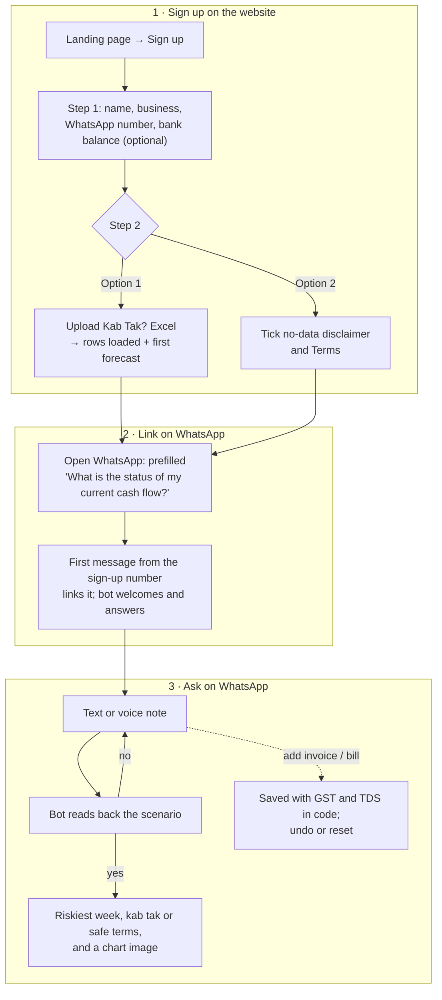

A number that has not signed up gets only the sign-up link and never sees anyone's data.

### How it addresses F-03

F-03 asks for predictive cash-flow management for small businesses. Kab Tak? predicts *when* money arrives (per-buyer curves, not due dates), turns that into a *probability* of a shortfall by week, simulates the shocks owners face (late buyer, expense, new order), and answers the decision ("how late can they be?", "what terms?"). It works on the owner's channel. The part of F-03 we have **not** delivered is comparing remedies by their cost (the fix search; §11, §13).

---

## 4. Innovation and differentiation

**What is original in the approach**

1. **Censored per-buyer payment curves.** An unpaid invoice is "not paid yet", not missing. A plain average of paid delays is biased toward fast payers: in the demo ledger, the public-sector buyer's paid-only median is 79 days, below its true 85, because its slowest invoices are still open (`python3 -m engine.ledger`).
2. **One shock per buyer.** A buyer who is late tends to be late on every invoice. With ρ = 0.6, the P10–P90 band of cumulative inflow over 90 days widens from ₹8.83 L (invoices independent) to ₹11.37 L (`python3 -m engine.simulate`), so the range is not falsely narrow. (On the IBM data this neither helped nor hurt; see §8.)
3. **A bank limit that moves.** Drawing power is recomputed every Monday and drops receivables older than 90 days, so a late buyer delays cash *and* shrinks the overdraft. As we read their documentation, TallyPrime's projection takes a fixed overdraft limit that you type in.
4. **The literal "kab tak?" answer.** The tool reports the largest delay per buyer, and the longest terms or smallest advance for an order, that keep risk within target. These come from bisection on common random numbers.
5. **The LLM is boxed in.** It produces a typed scenario that the owner confirms, and its prose passes a numeric check against engine-produced facts. The engine has no machine-learning library.

**How it differs from obvious or existing approaches**

| Approach | What it does | Kab Tak? difference |
|---|---|---|
| TallyPrime cash-flow projection | Receivables and payables by period, typed-in overdraft limit, memo vouchers for scenarios | Predicts lateness per buyer; drawing power moves; gives probabilities |
| Zoho Books cash-flow forecasting | Recurring items and assumptions; expected payment date typed in by the user | Learns payment timing from history |
| Float (Xero add-on), Xero Analytics, QuickBooks | Use predicted payment dates | Comparable on prediction; ours adds the shared buyer shock, the drawing-power rule, WhatsApp/voice in Indian languages, and decision answers. **Predicting payment timing is not new in the market.** |
| "Ask ChatGPT about my cash" | The LLM does arithmetic | The LLM never computes; numbers are checked |
| cashcast (open-source prototype on the IBM data) | TabPFN days-to-pay with independent invoices | We tried the shared-shock idea on the same data: no measurable gain (§8) |

Competitor descriptions come from their public pages as cited in `docs/planning/round2-pitch-script.md` and `f03-research-notes.md`. We have not used those products hands-on.

**Design decisions that make it useful**

- **WhatsApp first.** The owner needs no app and no login on the phone, and voice notes work.
- **A read-back before anything runs**, and *undo* and *reset* for saved entries. Speech-to-text can mishear amounts.
- **Thin history is stated, not hidden.** A business with fewer than 10 paid invoices gets a default curve, and the reply says forecasts sharpen as invoices are added.
- **A business is a folder.** Onboarding needs no migration. The bot and the web server are separate processes that see each other's writes through file modification times.
- **Plain stdlib HTTP server and plain JavaScript** for the website: no build step.

---

## 5. System architecture

### Architecture diagram

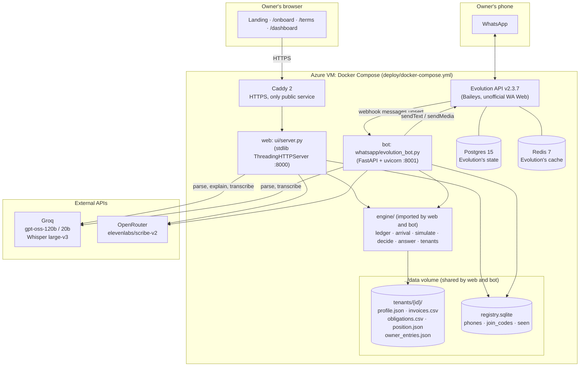

### Major components

| Component | Files | Role |
|---|---|---|
| Engine | `engine/ledger.py`, `arrival.py`, `simulate.py`, `decide.py`, `answer.py` | Data loading per business, KM curves, Monte Carlo, decisions, result JSON |
| Tenant registry | `engine/tenants.py` | Tenant folders and ids; SQLite phone ↔ business links, single-use join codes, de-duplication of webhook message ids |
| Web server | `ui/server.py` | Landing, sign-up, Terms, dashboard and JSON APIs |
| Excel onboarding | `ui/ingest.py`, `ui/make_template.py` | Fixed-layout workbook → tenant files; bad rows skipped and reported |
| LLM layer | `ui/llm.py` | Speech-to-text, parser (strict JSON schema), explainer with numeric check |
| Dashboard | `ui/index.html`, `ui/app.js` | Owner, CA and Story views |
| WhatsApp bot | `whatsapp/evolution_bot.py`, `reply.py`, `chart.py` | Webhook, routing per sender, read-back, reply text, chart PNG |
| Landing page | `landing-page/index.html` | Public page with an illustrative animation (labelled as such) |
| Validation | `validation/ibm_backtest.py` | External backtest on the IBM sample |
| Deploy | `Dockerfile`, `deploy/docker-compose.yml`, `deploy/Caddyfile` | One VM, HTTPS |

`whatsapp/app.py` (a Twilio/Meta Cloud API webhook) is an earlier alternative and is **not used** in the deployment.

### Data flow: one WhatsApp question

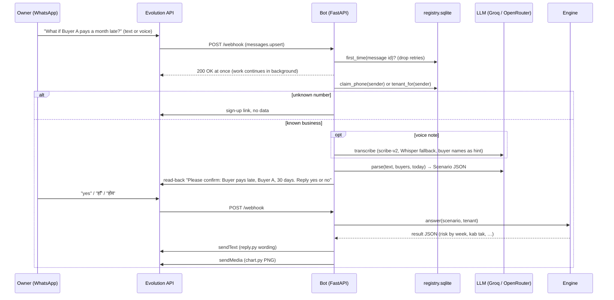

A `status` question skips the read-back, because it saves and changes nothing.

### Technology stack

| Layer | Technology (versions pinned in `Dockerfile`) |
|---|---|
| Language | Python 3.12 |
| Numerics | numpy 1.26.4, pandas 2.2.1 (no ML library in the engine) |
| Excel | openpyxl 3.1.5 |
| Bot web framework | FastAPI 0.162.0, uvicorn 0.49.0, httpx 0.28.1, python-multipart 0.0.32 |
| Charts | matplotlib 3.10.8 (WhatsApp image); hand-written SVG in `ui/app.js` (dashboard) |
| Website | Python stdlib `http.server`; plain HTML, CSS and JavaScript |
| WhatsApp gateway | Evolution API v2.3.7 (Baileys mode), PostgreSQL 15, Redis 7 |
| HTTPS | Caddy 2 with a Let's Encrypt certificate; host name via sslip.io |
| Hosting | One Azure VM, Docker Compose |
| Models (external) | Groq `openai/gpt-oss-120b` (fallback `gpt-oss-20b`) for parsing and phrasing; OpenRouter `elevenlabs/scribe-v2` for speech-to-text, Groq `whisper-large-v3` as fallback |

### APIs

**Website (`ui/server.py`)**

| Method and path | Purpose |
|---|---|
| `GET /`, `/onboard`, `/terms`, `/dashboard?tenant=<id>[&view=owner\|ca\|story]` | Pages |
| `GET /api/result?tenant=<id>` | Status result for a business (engine run) |
| `POST /api/signup` | `{owner_name, business_name, phone, bank_inr?}` → `{tenant_id, join_code, bot_number}` |
| `POST /api/onboard/excel` | `{tenant_id, join_code, filename, content_b64}` → rows loaded, rows skipped with reasons, first forecast. Allowed only while the join code is unused |
| `POST /api/onboard/terms` | Records Terms version and acceptance time in `profile.json` |
| `POST /api/answer` | Scenario JSON (+ `tenant`) → engine result |
| `POST /api/parse`, `/api/explain`, `/api/transcribe` | LLM parse, explain, speech-to-text for the dashboard's ask box |

**Bot:** `POST /webhook` and `POST /webhook/{event}` (Evolution's `messages.upsert`). It calls Evolution's `/message/sendText`, `/message/sendMedia` and `/chat/getBase64FromMediaMessage`.

**Engine (Python):** `engine.answer.answer(scenario, tenant)`, `undo(tenant)`, `reset(tenant)`, `reload(tenant)`; `engine.ledger.profile/load`; `engine.tenants.*`. The contract is in `docs/planning/multi-tenant-contract.md`.

### Database design

There is no application database server. State is files plus one SQLite file:

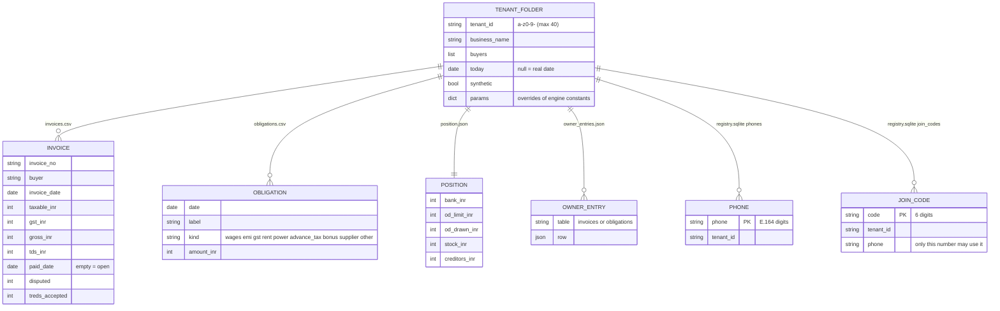

`registry.sqlite` also has `seen(msg_id PRIMARY KEY)` to drop webhook retries. Postgres and Redis belong to Evolution API (WhatsApp session state), not to Kab Tak?.

### How the components interact

- The web server and the bot are **separate processes** that import the same engine and share the `data/` volume. The engine caches each tenant's data and fitted curves, and drops the cache when any of the tenant's files changes size or modification time (`ledger._fresh`). So an Excel upload through the website is seen by the bot on its next answer.
- Sign-up creates an empty tenant folder and a join code bound to the sign-up phone number. The first WhatsApp message from that number claims the code and links the number (`tenants.claim_phone`); `JOIN <code>` is a fallback.
- Only Caddy is exposed publicly. Evolution's admin port is bound to 127.0.0.1 on the VM.

---

## 6. Implementation details

### Features completed

| Area | Completed |
|---|---|
| Engine | KM per buyer with censoring and pooled/default fallbacks; Monte Carlo with shared buyer shock, quarter-end slip, disputed invoices never paid, weekly drawing power; GST on accrual, TDS on receipts; 7 supported scenario types; kab tak; order terms; promised payment; owner entries with undo/reset; per-tenant parameters and caches |
| Website | Landing page; two-step sign-up; Excel upload (template and demo workbook downloadable); Terms page with acceptance recorded; dashboard with Owner/CA/Story views; ask box (voice or text) with confirmation; "Or build it by hand" form |
| WhatsApp | Evolution webhook; linking by first message or JOIN code; unknown numbers refused; read-back and yes/no in English, Hindi and Marathi (Devanagari or romanised); clarification follow-ups; voice notes; chart image; empty-ledger handling; file messages redirected to the website |
| Deploy | Docker image; one-VM compose with HTTPS |
| Validation | IBM public-dataset backtest with baselines and a self-check |

### Important algorithms and business logic

**Kaplan–Meier with censoring** (`engine/arrival.py::_km`). For each event day *t*: S ← S × (1 − deaths(t)/at_risk(t)). Open invoices contribute to "at risk" up to their current age.

**Conditional sampling** (`sample_delay`). For an invoice already `age` days old, draw the smallest *t* with S(t) ≤ (1 − u)·S(age). The draw is always later than `age`. If the curve never drops that low (slow public-sector tail), the invoice is "not paid in the horizon" (`NEVER`).

**Shared buyer shock** (`simulate.py`). u = Φ(ρ·z_buyer + √(1−ρ²)·z_invoice), a Gaussian copula with ρ = 0.6. All random draws are made up front from a fixed seed, so every scenario sees the same random numbers.

**Daily cash loop** (vectorised, 1,000 × 90).
`liquidity[t] = (bank − OD drawn) + Σ(receipts − obligations) + DP[t]`, where
`DP = min(limit, 0.75·max(0, stock − creditors) + 0.60·receivables younger than 90 days)`, recomputed on day 1 and every Monday.
A shortfall is counted only on days with an obligation: `shortfall[t] = max(0, −liquidity[t])`. An overdraft running negative is not a shortfall by itself; only a bill that cannot be paid is.

**Decisions** (`decide.py`). Threshold = 5%, or today's risk + 5 points if today is already above 5%. `kab_tak` bisects 0–120 extra days per buyer (the first three buyers in the profile). `order_terms` bisects the terms (0 to the requested terms, capped at 180) and scans the advance in 5% steps. The threshold is applied to the **90-day** chance of any shortfall. The headline shown to the owner is the **riskiest week's** chance.

**New-order model.** Bar stock (45% of value) is paid on day 7. Any advance is received on day 7. The invoice is raised on day 30, its GST is due on the 20th of the next month, and the balance net of TDS arrives after the terms plus a slip drawn from the reference buyer's curve. This makes the cash gap visible: the material and GST go out before the money comes in.

**Owner entries.** `add_invoice` computes GST, gross and TDS from the tenant's rates and numbers the entry `OWN-0001`, and so on. A new buyer name is added to the profile. Entries live in `owner_entries.json`, separate from the base ledger, so *undo* and *reset* restore the base exactly.

**Excel ingest** (`ui/ingest.py`). The column layout is fixed, and no LLM is used. The ingest accepts ISO or day-first dates and amounts like "₹1,25,000.00". It skips and reports duplicate invoice numbers, rows paid before they were invoiced, and blank or unreadable rows. Unknown bill kinds become `other`. More than 20 buyers are merged into "Other customers".

**Number check** (`ui/llm.py::_safe`). The explainer keeps only sentences whose every number appears among the formatted engine facts or in the question. If the first sentence fails, a fixed template sentence is used instead. Devanagari digits are normalised first.

### Major technical decisions

| Decision | Why | Trade-off |
|---|---|---|
| KM per buyer instead of an ML hazard model | Works with tens of invoices, handles censoring, explainable to a CA | No features (amount, season); too narrow with few invoices per customer (IBM result) |
| Monte Carlo instead of a closed form | Obligations, drawing power and quarter slips interact non-linearly | About 116 simulation runs for one order answer (§7) |
| Common random numbers + bisection | Monotone, reproducible decisions | Weekly drawing-power recompute makes risk only *near*-monotone (a 0.02 dip is tolerated in tests) |
| LLM only for parsing and phrasing | Correctness and auditability of every number | Depends on two external APIs; the numeric check is digits-only |
| Files per tenant + SQLite registry | No migrations, easy to inspect, works across two processes | No multi-machine scaling, no transactions across files |
| Evolution API (unofficial) | Works with a normal WhatsApp number during a hackathon | Risk of the number being banned; production should use the official Cloud API |
| English-only WhatsApp replies | The number check and wording were verified in English | Owners asking in Marathi get English answers |

### How it was built

The git history has 53 commits (43 excluding merges), from 24 Oct 19:31 to 26 Oct 08:38 IST, all authored as Sankalp Shankar. The work was split into parallel workstreams (engine, WhatsApp, onboarding, demo data, validation) on separate branches, each building against a written contract (`docs/planning/multi-tenant-contract.md`), and then merged. Claude (Anthropic) via Claude Code was used for research, planning, documentation and most of the code, as the README discloses (§9).

---

## 7. Achievements during the hackathon

### Milestones (from `git log`)

| When (IST) | Milestone | Commit |
|---|---|---|
| 24 Oct 19:31 | Repository created; research and planning docs | `13000a6`, `c6fb040` |
| 25 Oct 01:15–04:05 | Engine contract fixture; first WhatsApp adapter (Evolution); web UI; **cash-flow engine E1–E5 and synthetic ledger** | `1198371`, `f6fac6f`, `26e0bd0`, `cb9042c` |
| 25 Oct 05:16–07:43 | Ask in your own words (Groq parse/explain), number-checked explanations, voice input | `b2a9dfc`, `ce86ff8`, `2be29ee` |
| 25 Oct 10:15 | Dockerised; speech-to-text via OpenRouter scribe-v2 with Whisper fallback | `6600311` |
| 25 Oct 18:58 | **External validation on the IBM dataset** | `889cdbb` |
| 25 Oct 19:12–21:45 | Bot wired to the real engine; confirm step; chart; owner entries; promised payments | `718608c` to `626ee60` |
| 25 Oct 22:30–22:42 | **Multi-tenant**: contract, registry, per-tenant engine, onboarding, demo tenants; four branches merged | `ea2a37a` to `16fc4e4` |
| 26 Oct 08:23 | Landing page; two-step sign-up, Excel upload, Terms, linking by number; **one-VM deploy with HTTPS** | `743f2b0`, `e759c21` |
| 26 Oct 08:33–08:38 | Demo-breaker fixes (Devanagari yes/no, relinking, cross-process caches, Hindi STT, timeouts); docs | `4a0d65e`, `5c05e61`, `98c6f5d` |

### Measurable results

| Measure | Value | How measured |
|---|---|---|
| Engine size | 1,363 lines of Python (excluding its two test files); 1,585 with them | `wc -l` on tracked `engine/*.py` |
| Total tracked Python | 3,828 lines | `git ls-files '*.py' \| xargs cat \| wc -l` |
| Website + dashboard (`ui/`) | 2,484 lines (Python, JS, HTML) | `wc -l` |
| Simulation size | 1,000 paths × 90 days per scenario; 13 weekly risk buckets | `answer()` result `n_paths`, `weeks` |
| One simulation run (warm) | about 0.01–0.02 s | `python3 -m engine.simulate` (0.01 s/call); repeated `answer()` 0.02 s |
| Status answer, cold | 0.92 s (includes the kab-tak searches) | sample script, §8 |
| ₹12 L order answer, cold, fresh process | 1.75–1.78 s (3 runs), 116 distinct simulation runs | timed in a fresh process |
| Self-checks | 12 of 12 pass | §8 |
| IBM backtest | weekly 80% band held actual cash in 62.5% of 80 weeks (cashcast published: 67.5%) | `python3 -m validation.ibm_backtest` |
| Deployment | Website, dashboard and bot live on one VM with HTTPS | Live pages fetched for this report (§10) |
| Demo businesses | 3 synthetic (CNC shop, textile trader with no overdraft, 3-month-old snack maker) | `data/tenants/` |

The engine's cold times above are engine-only. A WhatsApp or dashboard answer also includes the LLM calls; their latency was not measured for this report. `docs/planning/round2-rehearsal.md` records 1.2–3.5 s for parsing on 25 Oct.

---

## 8. Testing and validation

### Self-checks (run for this report)

The project uses assert-based self-checks, not a test framework. Each module was run as below, with `KABTAK_DATA` set to a **fresh empty temp folder** so committed data is never touched. All 12 passed.

```bash
export KABTAK_DATA=$(mktemp -d)   # a fresh one per module was used
python3 -m engine.tenants; python3 -m engine.ledger; python3 -m engine.arrival; python3 -m engine.simulate
python3 -m engine.decide; python3 -m engine.answer; python3 -m engine.test_owner_entries; python3 -m engine.test_tenants
python3 -m whatsapp.evolution_bot; python3 -m whatsapp.reply; python3 -m ui.llm; python3 ui/ingest.py
```

| Self-check | What it covers | Result (time) |
|---|---|---|
| `engine.tenants` | Join codes single-use and bound to the sign-up number; `claim_phone`; `unclaimed`; message-id de-duplication; tenant-id validation (rejects `../x`, empty, uppercase) | ok (0.1 s) |
| `engine.ledger` | Rebuilds the demo ledger (seed 7); column layout; receivable ≈ ₹46 L ±5% (actual ₹47.09 L); >45-day overdue ≈ ₹27 L ±10% (₹26.41 L); empirical medians vs planted; obligation dates (GST 20th, wages 7th, EMI 5th); drawing power uncapped; headroom ₹5–7 L | ok (0.8 s) |
| `engine.arrival` | Fitted and sampled KM medians within 15% (or 6 days) of planted: Buyer A 64→61, Buyer B 45→44, CPSE 85→79, small customers 22→22; conditional draws always exceed age; monotone in u; pooled and default fallbacks (default median 45 ±1, σ 0.4 ±0.03) | ok (0.5 s) |
| `engine.simulate` | Zero-noise vectorised path equals a plain-Python day loop within ₹1; shared shock widens cumulative inflow band >15% (₹11.37 L vs ₹8.83 L); a ₹12 L order and Buyer A +30 days both raise risk (3.4% → 53.6% and 44.0%) | ok (0.6 s) |
| `engine.decide` | Risk monotone in delay (Buyer A: 5.8%, 14.4%, 34.4%, 69.6%, 100%, 100% at 0/10/20/40/60/90 days, 500 paths); bisection boundary exact; shorter terms and more advance never riskier; minimum advance is minimal | ok (0.9 s) |
| `engine.answer` | Result shape matches the frozen fixture; bad scenarios refused with messages; bridge reconciles (start + items = end); kab-tak curves near-monotone; a promised payment early lowers risk and late raises it, without leaking into the cache; a what-if dated today counts as tomorrow; a brand-new tenant with no data answers | ok (2.5 s) |
| `engine.test_owner_entries` | `add_invoice` ₹2 L → GST ₹36,000, gross ₹2,36,000, TDS ₹4,000; receivable and drawing power rise; undo restores the baseline exactly; a ₹5 L bill on 10 Nov takes 90-day risk 3.4% → 55.0% and worst week 2% → 45%; reset; bad entries rejected before writing | ok (6.3 s) |
| `engine.test_tenants` | Three tiny businesses in a temp root: no overdraft and no stock; default/pooled curves labelled; tenant's own GST/TDS/risk target; answers unchanged when other tenants run in between; unknown party lists only that tenant's buyers; empty sign-up tenant; another process rewriting files is picked up without `reload()` | ok (2.1 s) |
| `whatsapp.evolution_bot` | Webhook end to end with **engine and parser mocked**: strangers get only the sign-up link; JOIN codes (typed or spoken); first-message linking; per-sender tenant routing, interleaved; nothing runs before "yes"; retries processed once; clarification context; `@lid` senders; voice notes; yes/no in Devanagari and romanised Hindi/Marathi; re-sign-up moves a number; LLM timeout; documents; empty ledger | ok (1.1 s) |
| `whatsapp.reply` | Reply and read-back wording for every scenario type; Indian digit grouping; the order line; "forecasts get sharper" note for thin history | ok (0.1 s) |
| `ui.llm` | Number check keeps and drops the right sentences (incl. Devanagari digits); template fallback; parser prompt uses the tenant's buyers; pinned "today" never reaches the parser; Hindi-heard-as-Urdu retried as Hindi; request timeouts (network mocked) | ok (0.5 s) |
| `ui/ingest.py` | Bad rows skipped and reported by sheet and row; day-first dates; ₹-formatted amounts; unknown kind → `other`; bad workbooks refused; both downloadable workbooks load with no skipped rows and match `mahesh-cnc`; tenant writer; 30 buyers → 20 | ok (0.7 s) |

### Sample inputs and outputs (real engine runs, demo shop `mahesh-cnc`)

These come from running `engine.answer.answer()` on a temp copy of `data/`. "Today" is pinned to 25 Oct 2026, and the shop has bank ₹4.0 L, overdraft limit ₹42 L (₹23.8 L drawn), drawing power ₹29.09 L, headroom ₹5.29 L, owed ₹47.09 L, of which ₹26.41 L is more than 45 days old. The WhatsApp text is the exact output of `whatsapp/reply.py` for that result.

| # | Input (scenario) | Riskiest week | Chance in that week | Chance over 90 days | Decision output |
|---|---|---|---|---|---|
| 1 | `status` | 9 Nov (Power 10 Nov, bar stock 14 Nov) | 2% | 34 / 1,000 | Kab tak: Buyer A 3 days, Buyer B 11, CPSE 11 |
| 2 | `delay_payment` Buyer A, 30 days | 9 Nov | 28% | 440 / 1,000 | Buyer A can be at most 3 days late |
| 3 | `new_order` new buyer, ₹12 L, 90-day terms | 9 Nov | 51% | 536 / 1,000 | Safe terms 0 days; minimum advance 30%; margin ₹1.08 L; with the order, kab tak A 2, B 11, CPSE 3 |
| 4 | `expense_shock` ₹10 L on 9 Nov | 9 Nov | 98% | 998 / 1,000 | Weeks of 14 Dec (93%) and 7 Dec (55%) also fail |
| 5 | `expense_shock` ₹2 L on 9 Nov | 9 Nov | 10% | 143 / 1,000 | Above the 5% limit |

Reply texts (WhatsApp formatting marks `*bold*` and `_italic_` kept):

```text
[1 status — answered at once, no read-back]
✅ *Riskiest week: 9 Nov*
2% chance of running short, inside your 5% limit _(Power 10 Nov, Bar stock (supplier) 14 Nov)_

[2 read-back]
Please confirm:

*Buyer pays late*
• Buyer: *Buyer A*
• Delay: *30 days*

Reply *yes* or *no* (text or voice).
[2 reply after "yes"]
⚠️ *Riskiest week: 9 Nov*
28% chance of running short _(Power 10 Nov, Bar stock (supplier) 14 Nov)_

Buyer A can pay at most *3 days* late before risk rises.

[3 reply]
⚠️ *Riskiest week: 9 Nov*
51% chance of running short _(Power 10 Nov, Bar stock (supplier) 14 Nov)_

Even payment on delivery isn't safe. Ask for at least *30%* advance.

[4 read-back]
Please confirm:

*One-off expense*
• Amount: *₹10 L (₹10,00,000)*
• Date: *9 Nov 2026*

Reply *yes* or *no* (text or voice).
[4 reply]
⚠️ *Riskiest week: 9 Nov*
98% chance of running short _(Unplanned expense 9 Nov, Power 10 Nov, Bar stock (supplier) 14 Nov)_

Acceptable limit: 5%.
```

Read the "kab tak" numbers with care. "Buyer A can be 3 days late" is measured against the 90-day chance of *any* shortfall (threshold 5%; today 3.4%). It is not the riskiest-week figure shown in the headline.

### External validation: IBM public accounts-receivable sample

Re-run for this report with `python3 -m validation.ibm_backtest` (about 3 s). It reproduced the committed table exactly, with no diff to `results/ibm_validation.json`. Setup: 2,466 invoices from 100 customers (2012–13), cashcast's replay protocol (10 monthly origins × 8 weeks = 80 weeks), P10–P90 band from 2,000 simulated schedules.

| Model | Per-invoice 80% interval hit | Weekly cash 80% band hit | Weekly CRPS (lower is better) |
|---|---|---|---|
| Ours, invoices independent | 71.0% | 61.3% (95% CI 50–71%) | 142.3 |
| **Ours, shared buyer shock (ρ = 0.6)** | 71.0% | **62.5%** (52–72%) | 141.7 |
| Baseline: paid on the due date + residual spread | 82.2% | **77.5%** (67–85%) | 110.8 |
| Baseline: per-customer average delay + residual spread | 74.8% | 72.5% (62–81%) | 120.6 |
| Post-hoc diagnostic only: one pooled KM curve | 82.0% | 76.2% | 113.3 |
| cashcast (TabPFN), as published | 77.1% | 67.5% | not published |

What this says, honestly:

- **We did not beat the published 67.5%, and we did not reach the 80% the band is meant to hold.** With 80 weeks, the difference from cashcast is not statistically separable.
- **Both simple baselines beat our model** on this data (72.5% and 77.5% weekly). Our per-customer curves are too narrow when each customer has only 15–36 invoices (71% of actual payment dates fell inside our 80% interval).
- **The shared buyer shock is unvalidated.** In this dataset, the correlation of delays between two invoices to the same customer in the same month is only 0.076 (1,307 pairs). The shock moved coverage by one week in 80 and did no harm.
- The pooled-curve row was added after seeing the headline result. It is a diagnostic, not a claim, and the engine was not changed in response.
- The dataset may itself be synthetic, has no GST, overdraft or obligations, and never has unpaid invoices. It tests prediction and simulation only, not the shortfall probabilities.

### Validation methods summary

| Method | Status |
|---|---|
| Recovery of planted parameters on our synthetic ledger | Done (circular: we generated the data) |
| Equivalence of the vectorised simulator with a reference loop | Done (within ₹1) |
| Monotonicity and boundary checks of decisions | Done |
| External backtest of payment timing | Done (one dataset; not better than baselines) |
| Shortfall probabilities on a real business | **Not done** |
| Parser and speech-to-text accuracy (e.g. Marathi voice notes) | **Not measured**; rehearsal notes only |
| User testing with real owners or CAs | **Not done** |

### Edge cases handled (each verified by a self-check)

No overdraft or no stock; 1 to 20 buyers (more are merged); buyers with no paid history; a business with no data at all; disputed invoices; invoices past 180 days; a what-if dated "today"; promised payments larger than what the buyer owes (refused with the amount owed); payments already received (refused: "not supported yet"); duplicate webhook deliveries; webhook retries of "yes" (the scenario does not run twice); WhatsApp `@lid` sender ids; Hindi heard as Urdu script; LLM down (the reply says "a bit busy", and the dashboard offers the by-hand form).

### Known failures and quirks found while writing this report

1. **The "riskiest week" is picked after rounding to 2 decimals.** For the status case, the raw weekly chances are 1.7% (week of 9 Nov) and 2.2% (week of 14 Dec). Both round to 0.02, so the earlier week, 9 Nov, is reported (`engine/answer.py::_worst` works on the rounded `weeks`). The demo and pitch quote "9 Nov, 2%", which is what the code outputs, but by raw probability the riskiest week is 14 Dec.
2. **The website API lets anyone write to any business.** `POST /api/answer` with a `tenant` id and type `add_invoice` or `add_obligation` saves an owner entry, with no login. Verified only on a local temp copy, never on the live site. The README mentions that the *dashboard* has no login, but not that the API can write.
3. **Risk is near-monotone, not strictly monotone.** The Monday drawing-power recompute can make a few extra days of delay *lower* risk by about 1 point. The tests allow a 0.02 dip.
4. **The digits-only number check.** Numbers spelled as words, or a real engine number used for the wrong thing, can slip through the check (marked in code with a `ponytail:` comment).
5. **Assumption wording.** The "Quarter-end slip" line always says "around 31 Dec", but the code applies the slip at every quarter end. This only matters once a 90-day window crosses 31 Mar, 30 Jun or 30 Sep.
6. **The parser cannot produce the `other` bill kind.** `ui/llm.py` lists 8 kinds; the engine and Excel accept 9. Bills from WhatsApp are mapped to the closest kind, usually `supplier`.
7. **The bot keeps pending read-backs and clarifications in memory.** A restart between the question and the "yes" loses them, and the owner must ask again.
8. **The voice-note media fallback is unverified.** The `getBase64FromMediaMessage` path is marked "UNVERIFIED against a live server" in code. Voice notes on the live bot were tested by hand by the team; we did not re-test them for this report.

---

## 9. AI, data, and external dependencies

### AI tools used to build the project

- **Claude (Anthropic) through Claude Code** was used for research, planning, documentation and most of the code, as disclosed in the README. The event rules permit AI tools if their use is disclosed. The team reviewed the generated code; TODO (team): confirm, per member, which parts each person reviewed and can explain.
- This report was also drafted with Claude Code from the repository and from commands run on it.

### AI models used inside the product

| Use | Model and provider | Fallback | Guard rails |
|---|---|---|---|
| Question → typed scenario | `openai/gpt-oss-120b` on Groq, temperature 0, strict JSON schema | `openai/gpt-oss-20b` on HTTP 429 | Enumerated types and fields; owner confirms a read-back; engine validates every field |
| Answer → 3–4 plain sentences (dashboard) | same | same | Facts dictionary of pre-formatted engine numbers; numeric check; template fallback |
| Speech-to-text | `elevenlabs/scribe-v2` via OpenRouter | Groq `whisper-large-v3` (then `-turbo`), prompt-biased with the tenant's buyer names | Arabic-script output is re-run as Hindi; read-back before anything runs |

The WhatsApp reply text itself is template code (`whatsapp/reply.py`), not LLM prose. The LLM touches WhatsApp only through parsing and speech-to-text.

### Prompts and workflow

- **Parser prompt** (`ui/llm.py::_parse_prompt`). It gives today's date and the tenant's buyer names, and describes each scenario type with examples. Its rules: copy values only from what the owner said, never guess an amount, convert lakh and crore, read Devanagari digits, ask exactly one follow-up question when something is missing, and use `add_*` types only when the owner asks to save something.
- **Explainer prompt** (`EXPLAIN_PROMPT`). It sets tone from a graded verdict: ≤5% "yes"; under 25% "yes, but tight"; under 50% "risky"; otherwise "no". It forbids calculating, converting units, rounding, spelling numbers as words, jargon, and suggesting the overdraft as a fix.

### Datasets

| Dataset | Source | Use | Licence |
|---|---|---|---|
| `mahesh-cnc`, `shree-textiles`, `sai-snacks` | Generated by us (`engine/ledger.py` seed 7; `data/make_demo_tenants.py`) | Demo businesses | Ours; **synthetic** |
| `data/samples/kolhapur_auto_spares_sales_register.*` | Generated by us; a messy Tally-style register | Test file for a future importer (the upload does not accept it) | Ours; synthetic |
| IBM Watson sample "Accounts Receivable" (2,466 invoices) | Public mirror: `raw.githubusercontent.com/pthiagu2/DataMining/.../WA_Fn-UseC_-Accounts-Receivable.csv` | Backtest only; downloaded at run time, not committed | Not stated; possibly synthetic itself |
| cashcast published figures (67.5%, 77.1%) | github.com/StarKnightt/cashcast README | Comparison numbers only; not re-run | Quoted with attribution |

### Libraries, APIs and third-party services

- **Python libraries:** numpy, pandas, openpyxl, FastAPI, uvicorn, httpx, python-multipart, matplotlib (versions in §5). The IBM backtest uses the same stack plus `curl` for the download.
- **Services:** Groq API (chat completions, audio transcription), OpenRouter API (audio transcription), Evolution API (open-source WhatsApp gateway in Baileys mode), PostgreSQL, Redis, Caddy with Let's Encrypt, sslip.io (wildcard DNS for the VM's IP), Microsoft Azure (VM).
- **Data sent to third parties:** the owner's question text or voice note, the business's buyer names, and, for the dashboard explainer, the headline engine numbers go to Groq and/or OpenRouter. The full ledger is not sent. This is stated on `/terms`.

---

## 10. User interface and demonstration

All screenshots were taken for this report with headless Chrome. The live pages were fetched with GET requests only. Sign-up step 2 needs a sign-up, so it was taken from a **local** server (`python3 ui/server.py`) running against a temp copy of `data/`, never the live site.

**Landing page** (live, https://172-198-161-228.sslip.io/). The animated panel on the right is labelled "Synthetic demo shop · illustrative example, not a live forecast". Further down the page, a "Coming next" fixes panel is labelled as a mock-up with made-up costs.

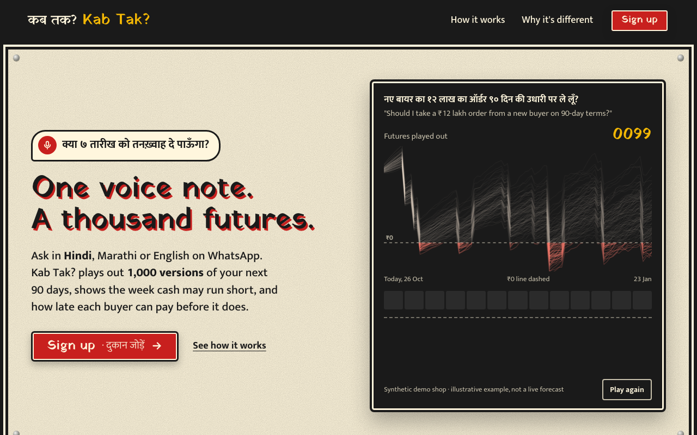

**Sign-up, step 1** (live, `/onboard`): name, business, WhatsApp number, optional bank balance.

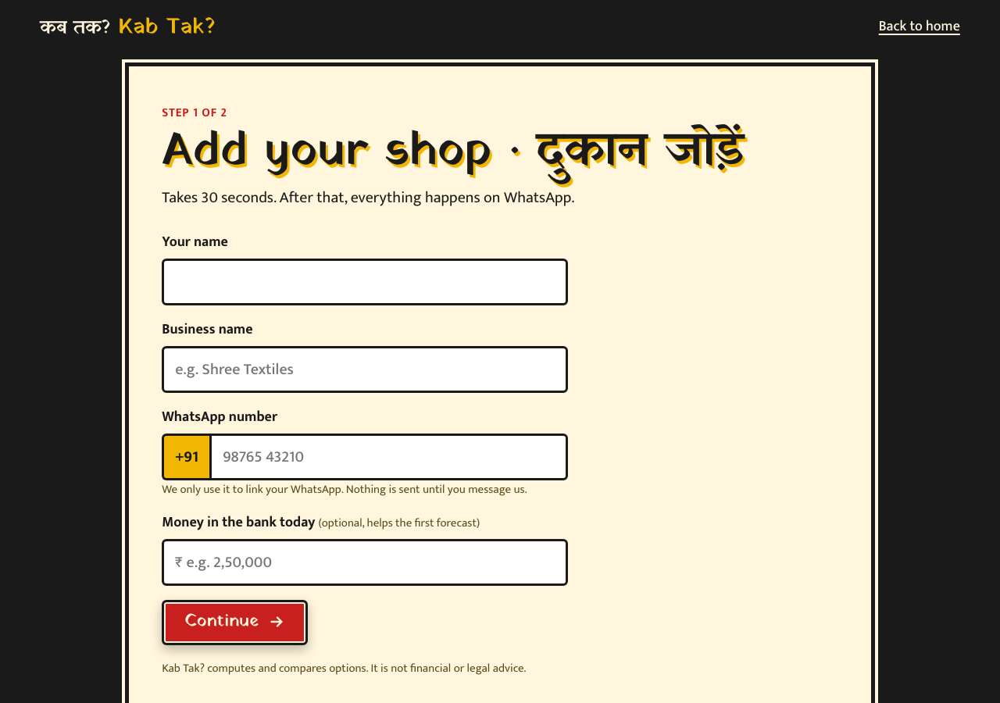

**Sign-up, step 2, two options** (local). Option 1 is the Excel upload. Option 2 is WhatsApp, which stays disabled until the owner ticks the "no data uploaded" disclaimer and agrees to the Terms. The phone number shown is a placeholder, not a real number.

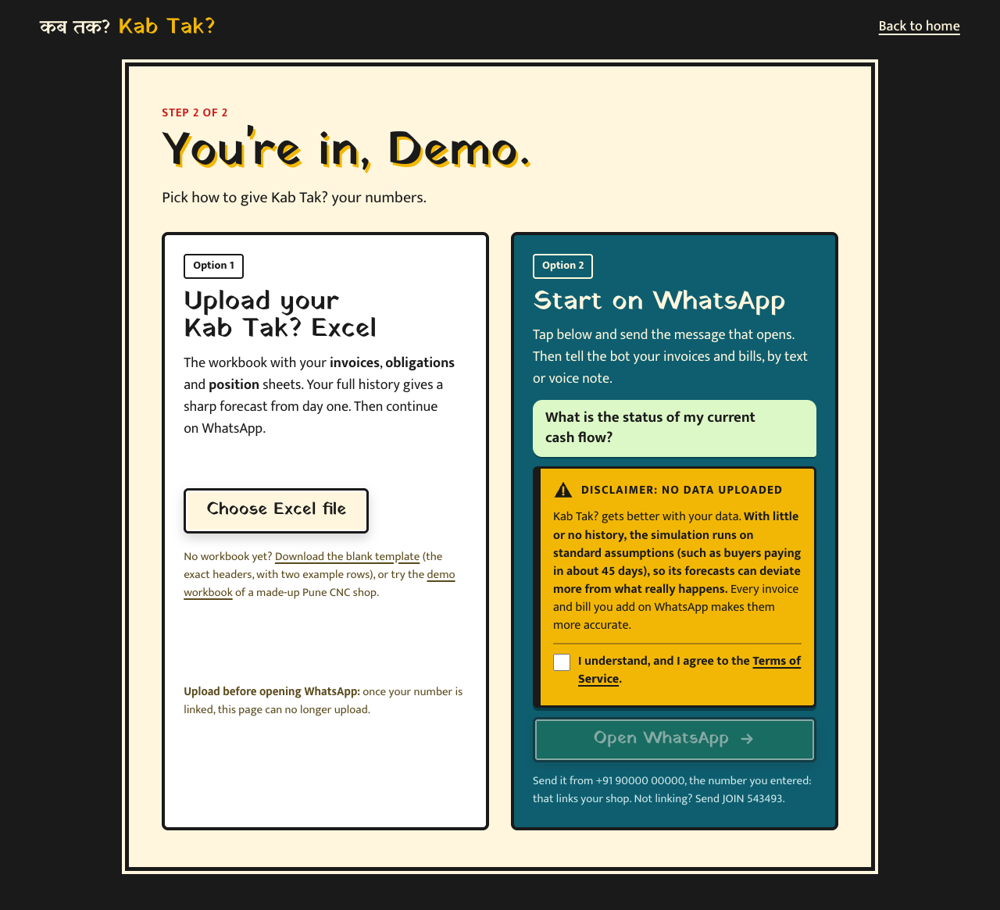

**Step 2 after uploading `ui/kabtak-demo.xlsx`** (local): 623 invoices (103 still open, including planned ones), 4 buyers, 24 bills; first forecast "Looks safe: 2% risk at worst". With data uploaded, the disclaimer is no longer required.

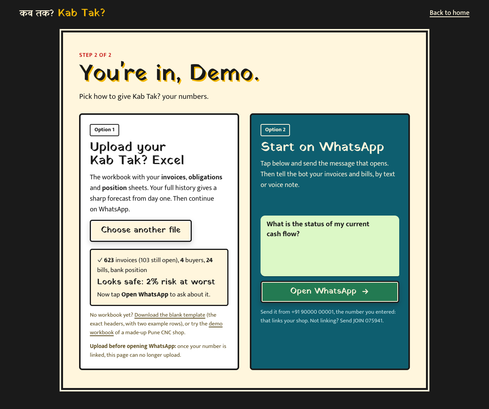

**Terms of Service** (live, `/terms`): prototype terms, marked as not reviewed by a lawyer.

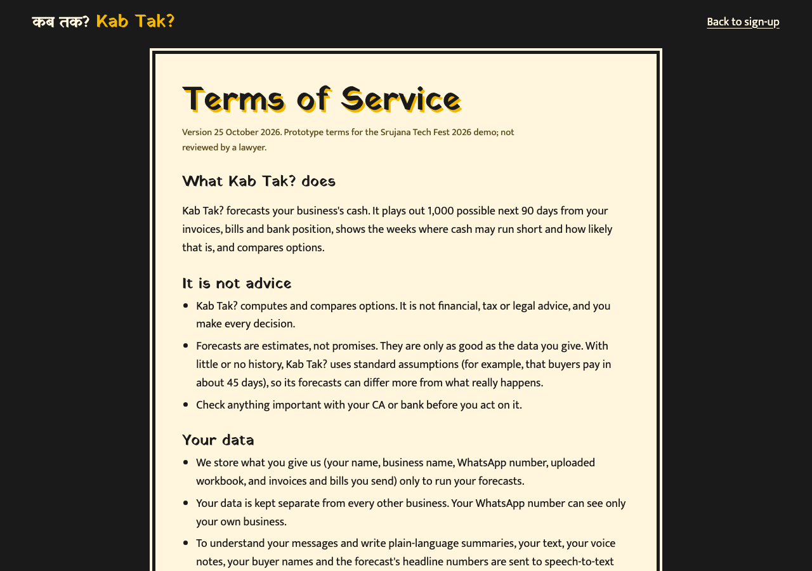

**Dashboard, Owner view** (live, `/dashboard?tenant=mahesh-cnc`): the verdict, with an English line and a Marathi line.

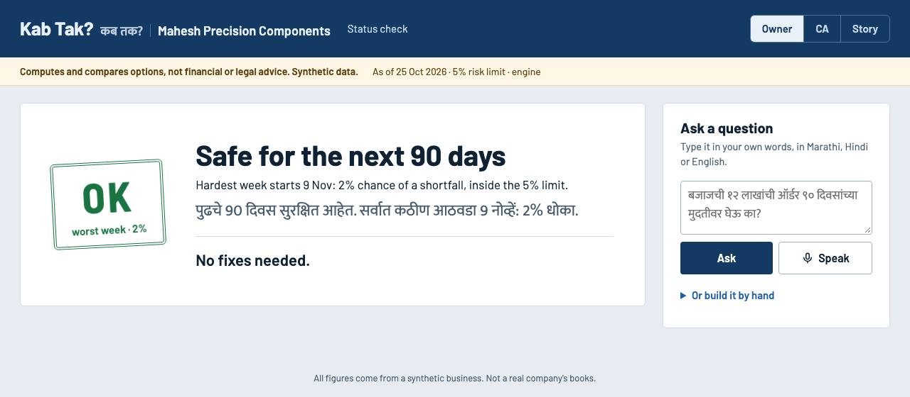

**Dashboard, CA view** (live, `&view=ca`), top: the verdict, today card (bank ₹4 L, headroom ₹5.3 L, owed ₹47 L, ₹26 L more than 45 days late), the 90-day fan chart, and the week-by-week table.

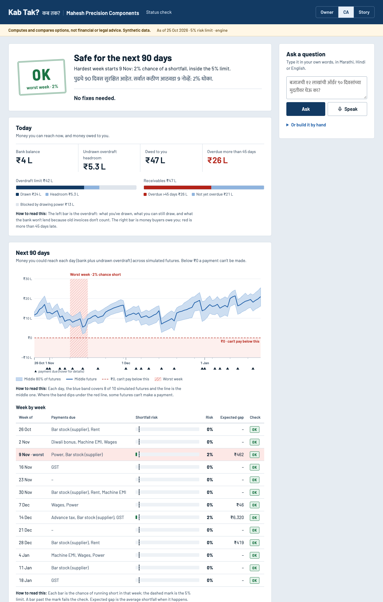

**CA view, middle:** fixes ("No fixes needed" when every week is safe; "Fix suggestions are coming next" otherwise), the kab-tak bars, and the risk-vs-days-late curves with a slider.

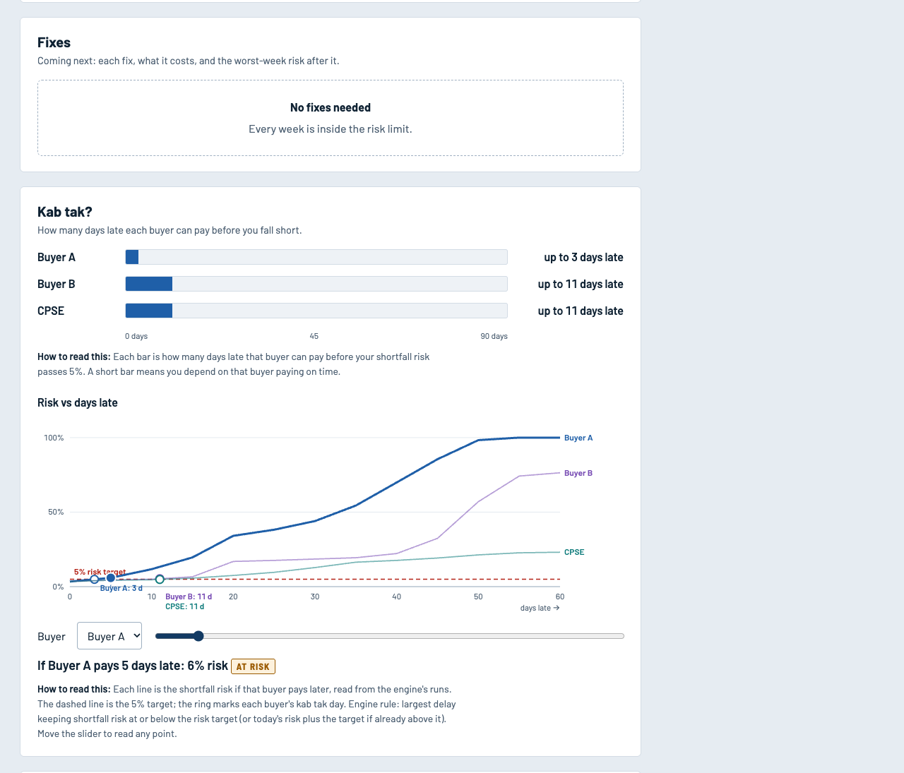

**CA view, bottom:** due on the invoice vs expected to arrive, per buyer by week, and the assumptions table.

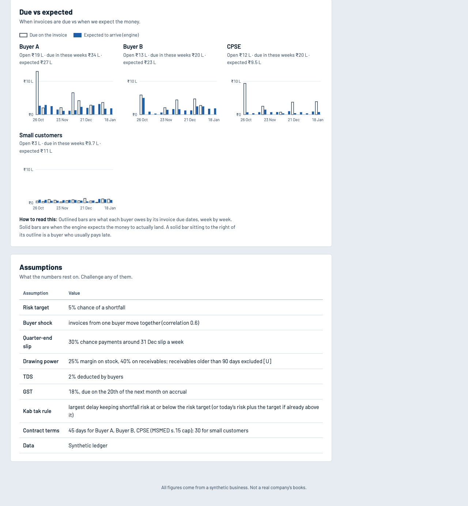

**Dashboard, Story view** (live, `&view=story`): a four-step walkthrough (books today → 1,000 futures → why that week → what changes it).

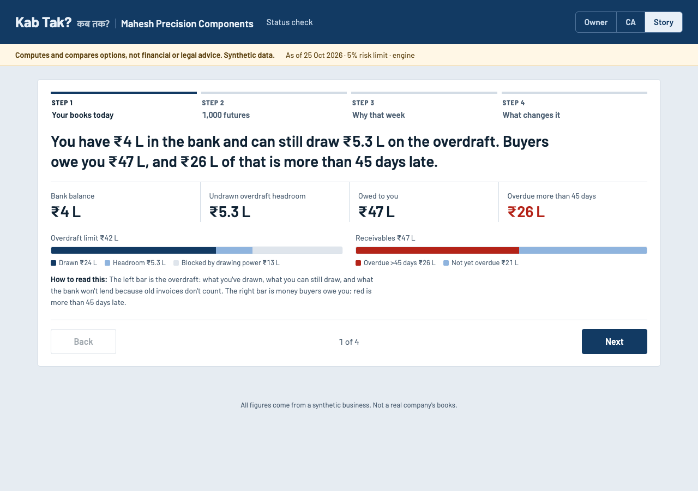

**WhatsApp.** We do not include a phone screenshot; none was taken for this report, and we will not fabricate one. The reply texts the bot sends are the exact `whatsapp/reply.py` outputs in §8. After each answer the bot sends this chart image (`whatsapp/chart.py`), shown here for sample 4, a ₹10 L expense on 9 Nov: the cash band (P10–P90 and median) above, and the weekly chance of running short below (red above the 5% line).

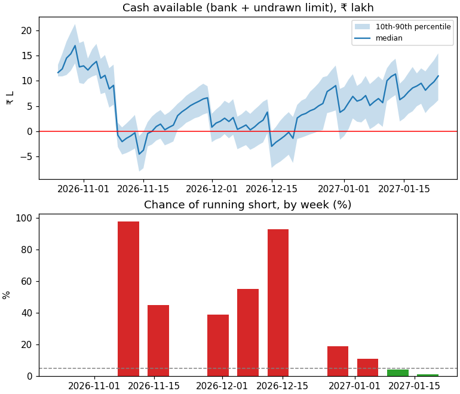

### Example workflow (demo script, `docs/planning/multi-tenant-demo.md`)

1. A stranger messages the bot and gets only the sign-up link.
2. The owner signs up on `/onboard` with their own number and uploads `kabtak-demo.xlsx`.
3. *Open WhatsApp* sends "What is the status of my current cash flow?". That first message links the number, and the bot welcomes the business by name and answers.
4. "What if Buyer A pays 30 days late?" → read-back → "yes" → riskiest week, kab tak and chart.
5. The same question from a second phone linked to `mahesh-cnc` gets that business's own answer.

### How to access

- Website and dashboard: https://172-198-161-228.sslip.io (demo dashboard: `/dashboard?tenant=mahesh-cnc`, also `shree-textiles` and `sai-snacks`).
- WhatsApp bot: +91 6205 559 096. Sign up on the website first with your WhatsApp number, then message the bot from that number. Use a test number if possible (§12).
- Locally: §14.

---

## 11. Limitations and incomplete work

### Demonstrated vs planned

| Capability | Status |
|---|---|
| Per-buyer payment curves, 1,000-path simulation, weekly risk, riskiest week | **Demonstrated** (live and in self-checks) |
| Kab tak per buyer; safe order terms and minimum advance | **Demonstrated** |
| Expense shock, promised payment, add invoice, add bill, undo, reset | **Demonstrated** |
| Sign-up, Excel upload, linking a number, multi-tenant isolation in the bot | **Demonstrated** (isolation verified by self-check with a mocked engine; live flow tested by hand by the team) |
| Voice notes in Hindi and Marathi | **Demonstrated by hand**; accuracy not measured |
| **Fix search** (pricing and ranking ways out: TReDS discounting, an advance, deferring a supplier, an MSMED notice) | **Not built.** The result always has `fixes: []` and `plan: null`; the dashboard says "Fix suggestions are coming next". The landing page's fixes panel is a labelled mock-up |
| `sales_drop`, `supplier_terms`, `schedule_change` scenarios | **Parsed, then refused** ("can't model that yet") |
| WhatsApp replies in Hindi or Marathi | **Not built** (English only; the dashboard summary can be Marathi or Hindi) |
| Tally or Zoho import | **Not built** (only the Kab Tak? workbook layout) |
| Legal levers (MSMED Act s.15/s.16 interest, Income-tax s.37(2)(g)/43B(h), the CGST 180-day rule) | **Research notes only**; the only legal reference in the output is the MSMED s.15 45-day cap, used as the contractual due date |
| Recording a payment already received | **Not supported** (refused with a message) |
| A first safe date, or the largest affordable purchase per date | **Not built** |
| Hazard model with features (amount, month-end, DSO) | **Not built**; plain KM is used |

### Mocked or test-only

- `fixtures/engine_result.json` is a frozen **placeholder** result (`placeholder: true`). The `whatsapp.reply` check, the chart self-check and the bot self-check use it, and the landing-page animation uses placeholder numbers. The bot's self-check mocks **both the engine and the parser**. The engine has its own checks, but no automated test runs the bot against the real engine and a real LLM.
- `whatsapp/app.py` (Twilio/Meta) is an unused alternative.

### Assumed, not fitted or verified

Buyer correlation 0.6; quarter-end slip 30%; drawing-power margins (25% on stock, 40% on receivables) and the 90-day exclusion; GST 18% on accrual; TDS 2%; the 45-day default payment curve for thin history; the new-order model (45% bar stock on day 7, invoice on day 30, 9% margin), which is **specific to a CNC job shop**; stock and supplier creditors held constant over 90 days. None has been checked with a banker or CA.

### Data and validation

- **All demo data is synthetic.** The persona is a constructed composite and has not been validated with real owners.
- The model is checked against values we planted (circular) and on one external dataset, where it lost to simple baselines (§8).
- **No real owner has used it.** The shortfall probabilities have never been compared with real outcomes.

### Security, legal and operations

- **No login** on the dashboard or the website APIs. A business id is a name plus 4 random hex characters, which is guessable. Anyone with the id can **view** the business and **add invoices or bills** to it through `POST /api/answer` (§8, failure 2).
- **The Terms of Service are a prototype**, not reviewed by a lawyer.
- **Unofficial WhatsApp protocol** (Evolution API, Baileys mode): the bot's number can be banned.
- **One message at a time:** a global lock in the bot serialises every sender.
- The bot's pending confirmations are in memory and are lost on restart.

---

## 12. Real-world viability and impact

### Intended users and practical benefit

Indian micro and small businesses that sell on credit to a few larger buyers and run on an overdraft: job shops, traders and food producers. The benefit is earlier warning and a negotiating number. "We can take 90-day terms only with a 30% advance" is something an owner can say to a buyer the same day. CAs get the working (assumptions, bridge, curves) rather than a black box.

### Feasibility

- **Compute is cheap:** one answer is under 2 s of CPU on a laptop-class core, with no GPU and no model training.
- **The data an owner needs is what their CA already keeps:** invoice dates, paid dates, bills, and the bank position.
- **Integrations still missing:** a Tally/Zoho export importer and the official WhatsApp Cloud API. Both are well-trodden paths.

### Scalability

The design today is one VM, files per business, and a global lock in the bot. That is fine for a pilot of tens of businesses. Scaling needs per-sender locks or a queue, a proper database for the registry and entries, and stateless workers. Engine runs are independent per business, so they parallelise easily.

### Security and privacy

- The ledger stays on the VM disk. Only question text, voice, buyer names and headline numbers go to the LLM and speech providers, and the Terms say so.
- **Must fix before any real data:** authentication for the dashboard and APIs, especially the write path; encryption at rest; access logging; and a data-deletion path. The README already warns not to put real data behind the dashboard yet.
- Prompt injection cannot change a number the owner sees, because numbers come only from the engine. It could still produce a wrong scenario, which is why the owner confirms the read-back.

### Risks

| Risk | Mitigation in place | Still open |
|---|---|---|
| Wrong forecast trusted as advice | "Not financial or legal advice" on every page and in the Terms; assumptions listed; ranges, not a single line | No real-world calibration |
| Misheard amount in a voice note | Read-back with the amount written both ways (₹10 L and ₹10,00,000) and a yes/no step; undo | — |
| Thin history | Pooled/default curves, stated in the result and the reply | Default curve is generic |
| WhatsApp ban | Use a spare SIM | Move to the Cloud API |
| Data exposure | Business id not linked from anywhere public | No authentication |

### Financial and legal limitations

- Kab Tak? computes and compares. It does not lend, advise, or give tax or legal opinions.
- Drawing-power rules, GST timing and TDS rates vary by bank, business and contract. The defaults are assumptions and are configurable per business.
- Processing businesses' financial data would bring obligations under India's Digital Personal Data Protection Act, 2023 (for the owner's personal data) and contractual confidentiality to clients. The prototype Terms are not a compliant privacy notice.
- Using the unofficial WhatsApp protocol may breach WhatsApp's terms of service.

---

## 13. Future scope

**Next build (in order, from `docs/planning/round2-done-next.md`):**

1. **Fix search.** A greedy search over bundles of fixes, scored on the same 1,000 paths and common random numbers. Version 1 covers only levers the engine already models: deferring a payment, asking for an advance, changing order terms. Then TReDS discounting, an overdraft draw within drawing power, and MSMED s.16 interest as a priced lever.
2. Wire fixes into the dashboard (the UI already renders `fixes` and `plan`) and into the WhatsApp reply.
3. Replies in the owner's language on WhatsApp, with the number check extended to Devanagari text.
4. Login for the dashboard and APIs, and the official WhatsApp Cloud API.

**Model improvements:** shrink per-buyer curves toward a pooled curve when history is short. This was the IBM diagnostic, and it would need fresh validation on data we haven't looked at. Also: a hazard model with features (amount, quarter-end, festival season), and fitting ρ and the quarter-end slip from real ledgers.

**What real-world deployment would require:**

- Pilots with real owners and CAs, measuring forecast calibration (did weeks flagged at 20% fail about 20% of the time?) and usability.
- A Tally/Zoho importer, and bank-statement reconciliation for "money already received".
- Verifying drawing-power and GST/TDS assumptions with bankers and CAs, per business.
- Authentication, encryption, audit logs, a lawyer-reviewed privacy notice and Terms, and data-retention controls.
- Production infrastructure: a queue, per-business locks, a managed database, monitoring and backups.

---

## 14. Setup and reproducibility

### Requirements

Python 3.12 and pip. Docker is optional. Speech and LLM features need API keys; everything else runs offline.

```bash
git clone https://github.com/sankalp-happy/Srujana_hackathon2026_KabTak.git
cd Srujana_hackathon2026_KabTak
pip install numpy==1.26.4 pandas==2.2.1 openpyxl==3.1.5 fastapi==0.162.0 uvicorn==0.49.0 httpx==0.28.1 python-multipart==0.0.32 matplotlib==3.10.8
```

### Run

```bash
python3 ui/server.py                                  # landing, sign-up and dashboard on http://localhost:8000
uvicorn whatsapp.evolution_bot:app --port 8001        # WhatsApp bot (needs Evolution API: whatsapp/evolution/README.md)
docker compose up --build                             # website only, in Docker, on http://localhost:8000
```

On one VM, as deployed:

```bash
cd deploy && docker compose --env-file .env.evolution up -d --build
docker compose exec bot python -m engine.tenants link 91XXXXXXXXXX mahesh-cnc    # link a phone to a demo business by hand
```

### Environment variables (names only; never commit values)

| Variable | Used by | Meaning |
|---|---|---|
| `GROQ_KEY` (or `GROQ_API_KEY`) | `ui/llm.py` | Groq key for parsing, explaining and Whisper. Read from the environment or a git-ignored `.env` in the repo root |
| `OPENROUTER_KEY` | `ui/llm.py` | OpenRouter key for scribe-v2 speech-to-text |
| `GROQ_MODEL`, `STT_MODEL` | `ui/llm.py` | Optional model overrides |
| `KABTAK_DATA` | engine | Data root (default `data/`). Point it at a temp folder for tests |
| `KABTAK_RESULT` | `ui/server.py` | Serve a fixture instead of running the engine |
| `HOST`, `PORT`, `BOT_NUMBER` | `ui/server.py` | Bind address, port, bot number shown at sign-up |
| `ONBOARD_URL` | bot | Sign-up link sent to unknown numbers |
| `EVOLUTION_URL`, `EVOLUTION_INSTANCE`, `AUTHENTICATION_API_KEY` | bot | Evolution API location, instance and key |
| `SITE` | `deploy/` | Public host name for Caddy |
| Evolution's own: `SERVER_URL`, `DATABASE_*`, `CACHE_REDIS_*`, `POSTGRES_*` | Evolution API | See `whatsapp/evolution/.env.example` |

Without LLM keys, the dashboard's "Or build it by hand" form still runs every supported scenario, and the bot answers "I'm a bit busy right now" to free text.

### Reproduce the evidence in this report

```bash
export KABTAK_DATA=$(mktemp -d)
for m in engine.tenants engine.ledger engine.arrival engine.simulate engine.decide engine.answer \
         engine.test_owner_entries engine.test_tenants whatsapp.evolution_bot whatsapp.reply ui.llm; do python3 -m $m; done
python3 ui/ingest.py
python3 -m validation.ibm_backtest       # downloads the IBM CSV to data/raw/ (git-ignored) if missing
```

Sample answers (§8):

```bash
KABTAK_DATA=$(mktemp -d) python3 -c "
from engine.answer import answer; from whatsapp.reply import format_reply
for s in [{'type':'status'}, {'type':'delay_payment','party':'Buyer A','days':30},
          {'type':'new_order','party':'New buyer','amount_inr':1200000,'days':90},
          {'type':'expense_shock','amount_inr':1000000,'date':'2026-11-09'}]:
    r = answer(s); print(r['worst_week'], r['n_short_paths'], r['kab_tak'], r['order']); print(format_reply(r)); print()"
```

A fresh `KABTAK_DATA` rebuilds `mahesh-cnc` from seed 7. The rebuilt files are byte-identical to the committed `data/tenants/mahesh-cnc` files (checked with `cmp`), with "today" pinned to 25 Oct 2026, so the numbers are reproducible on any date.

### Test credentials and demo data

- There are no logins and no test credentials.
- Demo businesses (all synthetic): `mahesh-cnc` (CNC shop, ₹42 L overdraft, 4 buyers), `shree-textiles` (no overdraft, 5 buyers, 5% GST), `sai-snacks` (3 months old, 8 paid invoices, default curve).
- Workbooks: `ui/kabtak-template.xlsx` (blank with two example rows) and `ui/kabtak-demo.xlsx` (the `mahesh-cnc` ledger); both are also downloadable from `/onboard`.

---

## 15. Team contributions and references

### Team

| Member | Role and contribution |
|---|---|
| Sankalp Shankar | TODO (team): describe role and contribution. The git history attributes all 53 commits to this account, including merges of the parallel workstream branches. |
| TODO (team): member 2 name | TODO (team): role and contribution |
| TODO (team): member 3 name (if any) | TODO (team): role and contribution |
| TODO (team): member 4 name (if any) | TODO (team): role and contribution |

The rules require 2 to 4 members. **TODO (team):** list every registered member and what each one built, researched, tested or presented. Do not rely on git authorship alone, since all commits came from one account.

**What the git history shows was built** (by area, not by person): engine and synthetic ledger (25 Oct early morning); web UI and LLM ask box (25 Oct); WhatsApp bot on Evolution API wired to the engine (25 Oct evening); IBM validation (25 Oct); multi-tenant engine, registry, onboarding and demo tenants as four parallel branches (25 Oct night); landing page, two-step sign-up, Terms and one-VM deploy (26 Oct morning); demo-breaker fixes and documentation (26 Oct).

**AI assistance:** Claude (Anthropic) via Claude Code helped with research, planning, documentation and most of the code (§9).

### References

- Srujana Tech Fest 2026 rules and judging rubric: `docs/planning/srujana-2026-rules.md`.
- Kaplan, E. L. and Meier, P. (1958). Nonparametric estimation from incomplete observations. *Journal of the American Statistical Association*, 53(282), 457–481.
- Abramowitz, M. and Stegun, I. A. (1964). *Handbook of Mathematical Functions*, formula 7.1.26 (the erf approximation in `engine/simulate.py::_phi`).
- IBM Watson Analytics sample "Accounts Receivable" (public mirror): https://raw.githubusercontent.com/pthiagu2/DataMining/master/WA_Fn-UseC_-Accounts-Receivable.csv
- cashcast (TabPFN payment-timing prototype, published replay figures): https://github.com/StarKnightt/cashcast
- GAME–FISME–C2FO, *Delayed Payments Report 3.0* (Nov 2025), ₹7.34 lakh crore delayed payments to MSMEs as of Mar 2024; GAME–D&B (2022), ₹10.7 lakh crore. As collected in `docs/planning/f03-research-notes.md`.
- TallyPrime Cash Flow Projection help: https://help.tallysolutions.com/tally-prime/accounting-financial-reports/cash-flow-and-projection-report-tally/
- Zoho Books expected payment date: https://www.zoho.com/us/books/kb/reminders/rem-epd.html ; AI features: https://www.zoho.com/in/books/help/ai-features/ai-features.html
- Float for Xero: https://apps.xero.com/us/app/float-cashflow-forecasting
- Micro, Small and Medium Enterprises Development Act, 2006, ss.15–16 (payment within 45 days; interest on delay). Used only as the contractual-terms cap in the due-vs-expected view.
- Evolution API: https://github.com/EvolutionAPI/evolution-api

### Relevant links

- Repository: https://github.com/sankalp-happy/Srujana_hackathon2026_KabTak
- Live site: https://172-198-161-228.sslip.io · WhatsApp bot: +91 6205 559 096
- Engine internals: `docs/planning/engine-how-it-works.md` · Validation: `docs/planning/validation-ibm.md` · Multi-tenant contract: `docs/planning/multi-tenant-contract.md` · Demo script: `docs/planning/multi-tenant-demo.md`
- Demo video: TODO (team): add the submitted demo video link.

### Acknowledgements

numpy, pandas, openpyxl, FastAPI, uvicorn, httpx and matplotlib; Evolution API, PostgreSQL, Redis and Caddy; Groq and OpenRouter for model access; IBM for the public sample dataset; the cashcast author for publishing a reproducible baseline; and the Srujana Tech Fest 2026 organisers, mentors and volunteers. TODO (team): add any mentors or people to thank by name.
